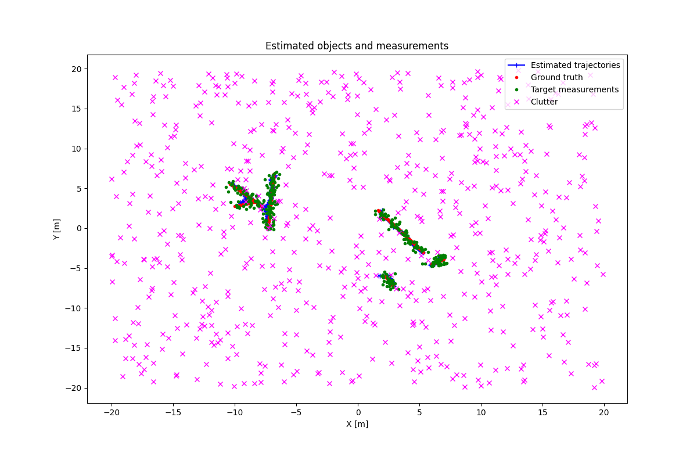
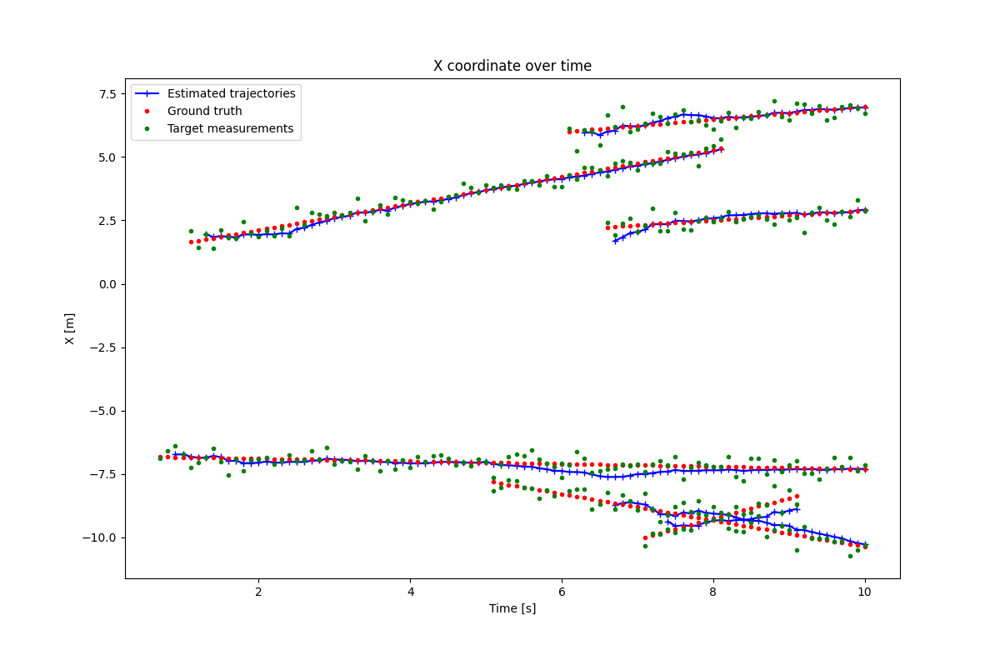
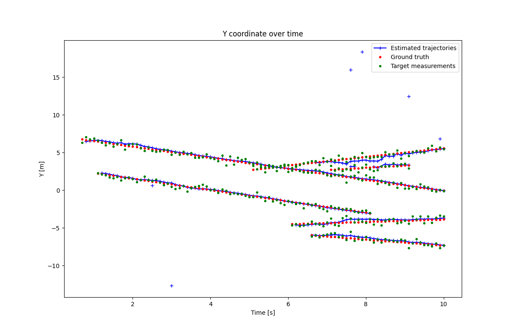
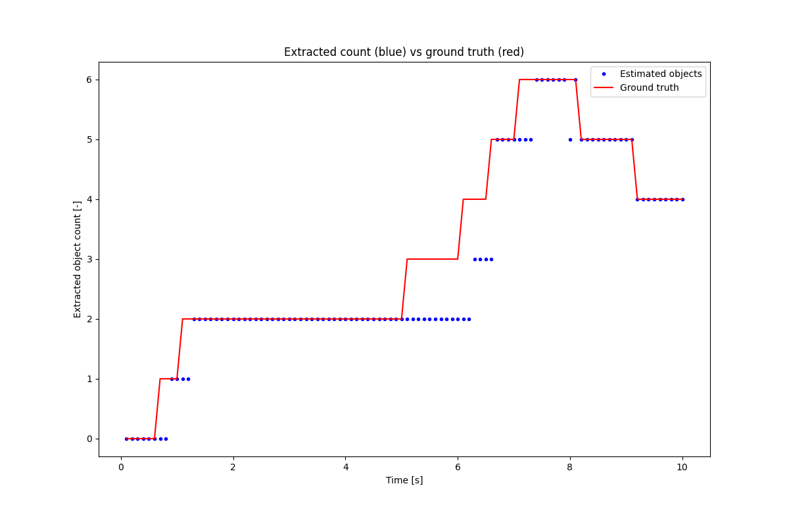
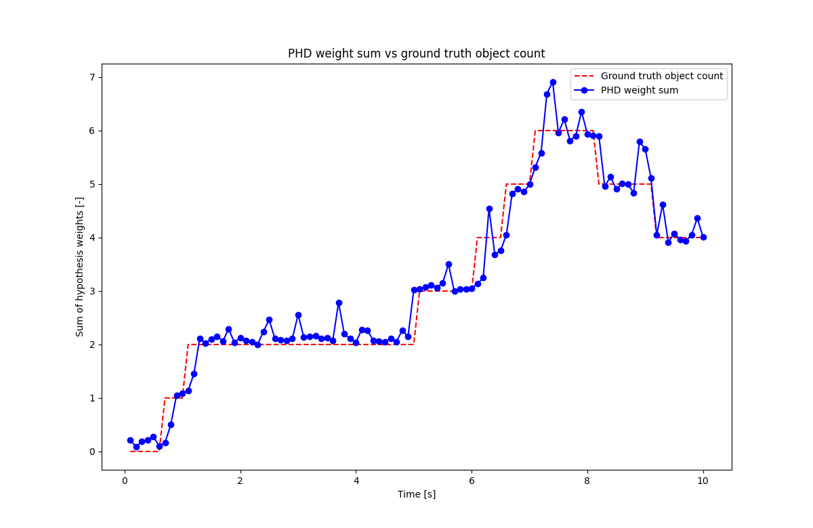
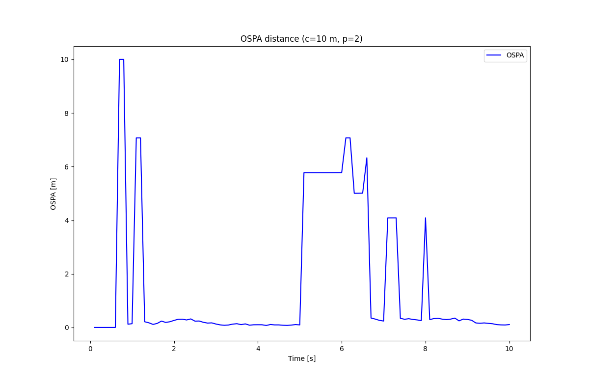

<div align="center">

# GM-PHD

### Gaussian Mixture Probability Hypothesis Density filter in modern C++

Multi-object tracking without explicit data association.

[](https://isocpp.org/)
[](https://cmake.org/)
[](https://eigen.tuxfamily.org/)
[](https://www.codefactor.io/repository/github/borodziejciesla/gm-phd)

</div>

## Overview

`gm-phd` is a header-oriented C++ implementation of the Gaussian Mixture
Probability Hypothesis Density (GM-PHD) filter for tracking multiple objects
from noisy measurements.

The filter represents the multi-object state as a mixture of Gaussian
hypotheses. This makes it possible to track targets that can:

- appear and disappear over time,
- move simultaneously in the same scene,
- be observed with noise and missed detections,
- change in number without assigning measurements to individual tracks.

The current example uses a constant-velocity (CV) motion model and generates a
random scene with a varying number of objects, dynamic births and deaths,
measurements, filtering, and plots.

The simulation sends all target and clutter measurements through the filter,
including the measurement-conditioned birth model. The example uses fixed seeds
so runs are reproducible.
Its detection probability is set to 1 because the simulation does not generate
missed target detections. The birth model's velocity variance matches the
uniform `[-1, 1]` velocity prior used by the scene generator. Measurement-born
hypotheses use a low initial weight (`0.001`) to limit false tracks from
clutter; the birth weight and clutter intensity should be retuned for different
scenes. The example deliberately uses an observation covariance of `0.36 I`
for generated measurements whose covariance is `0.09 I`, making tracks
smoother at the cost of a small increase in localization error. The reported
OSPA depends on the simulation seeds and selected calibrations, and is not a
general performance guarantee.

Before plotting, the example now evaluates filter configurations on fifty
deterministic simulation runs and tunes `ps`, `kappa`, the pruning threshold,
the merging threshold, and the extraction threshold by coordinate search.
Each candidate is scored by its mean OSPA across the same runs; the lowest
scoring tested value is selected for each parameter in turn. `pd` stays at 1.0
because this simulation does not generate missed detections. The plots show
the selected configuration on the first run. This is a small reproducible
search for this example, not a substitute for validation on held-out or
application-specific data.

## Example

The tuned run writes six PNG plots to `fig/` in the current working directory.
Each plot includes a legend:

- `positions_xy.png` compares estimated object trajectories with simulated
  ground truth, noisy target measurements, and clutter in the XY plane.

  

- `x_vs_time.png` and `y_vs_time.png` show estimated positions over time
  alongside ground truth and target measurements. Blue detections are linked
  into estimated trajectories.

  

  

- `object_count.png` compares the number of extracted objects per scan with
  the true number of active targets.

  

- `phd_weight_sum.png` compares the sum of PHD hypothesis weights with the
  true object count. The weight sum is an estimate of expected cardinality,
  not the count of threshold-extracted objects.

  

- `ospa.png` shows the per-scan OSPA distance using a 10 m cutoff and order 2.
  OSPA combines localization and cardinality errors; unmatched objects
  contribute the cutoff penalty.

  

## Requirements

### Core library

- CMake 3.22 or newer
- A compiler with C++26 support (C++2c is used with older CMake versions)
- [Eigen3](https://eigen.tuxfamily.org/)
- [oneTBB](https://github.com/oneapi-src/oneTBB)

### Visualization example

The optional example additionally requires:

- Python 3
- NumPy
- Matplotlib
- Python development headers and libraries

## Build

Clone the repository and configure a build directory:

```bash
git clone https://github.com/borodziejciesla/gm-phd.git
cd gm-phd

cmake -S . -B build \
  -DBUILD_TESTS=ON \
  -DBUILD_EXAMPLE=ON
cmake --build build -j
```

Run the tests:

```bash
ctest --test-dir build --output-on-failure
```

Run the visualization example:

```bash
./build/example/gm-phd_example
```

The example opens Matplotlib windows and prints the number of currently
extracted objects and the sum of their hypothesis weights for every scan.

To build only the library and tests, leave the example disabled:

```bash
cmake -S . -B build -DBUILD_EXAMPLE=OFF -DBUILD_TESTS=ON
cmake --build build -j
```

## Minimal usage

The filter is configured with a motion model and a birth model:

```cpp
#include "birth_model_dummy.hpp"
#include "cv_motion_model.hpp"
#include "gm_phd.hpp"

using Filter = mot::GmPhd<mot::CvMotionModel, mot::BirthModelDummy>;

Filter filter;
filter.SetCalibrations(
    "pd", 0.9,                    // probability of detection
    "ps", 0.95,                   // probability of survival
    "kappa", 0.01,                // clutter intensity
    "truncation_threshold", 0.01,
    "merging_threshold", 4.0);

filter.Run(timestamp, measurements);
const auto& objects = filter.GetObjects();
```

The CV model uses a four-dimensional state:

```text
[ x, vx, y, vy ]
```

Measurements contain position only:

```text
[ x, y ]
```

`Run(timestamp, measurements)` uses the scan's measurements for both the
measurement update and measurement-conditioned birth hypotheses.

## Project layout

```text
include/
  gm_phd.hpp              GM-PHD filter implementation
  cv_motion_model.hpp     constant-velocity model
  birth_model_base.hpp    birth model interface
src/
  cv_motion_model.cpp     CV model implementation
example/
  example.cpp             dynamic multi-object simulation and visualization
tests/
  *_test.cpp              unit tests
fig/
  *.png                   example plots
```

## Algorithm

For every measurement scan, the filter performs:

1. prediction of existing hypotheses using the motion model,
2. prediction of birth hypotheses,
3. measurement update,
4. pruning and merging of Gaussian components,
5. extraction of object states.

The implementation uses Eigen for matrix operations and oneTBB for the
parallel algorithms used by the filter.

## References

The implementation is based on:

- Zachary Prihoda, Arec Jamgochian, Ben Moore, Bernard Lange,
  *Probability Hypothesis Density Filter Implementation and Application*.
- Karl Granström, Christian Lundquist, Umut Orguner,
  *A Gaussian Mixture PHD Filter for Extended Target Tracking*.
- Karl Granström, Christian Lundquist, Umut Orguner,
  *Extended Target Tracking Using a Gaussian Mixture PHD Filter*.
- Wenling Li, Yingmin Jia, Junping Du, Fashan Yu,
  *Gaussian Mixture PHD Filter for Multiple Maneuvering Extended Targets Tracking*.

## Status

This project is an evolving research and experimentation implementation.
Interfaces and calibration names may change as additional motion and birth
models are added.
