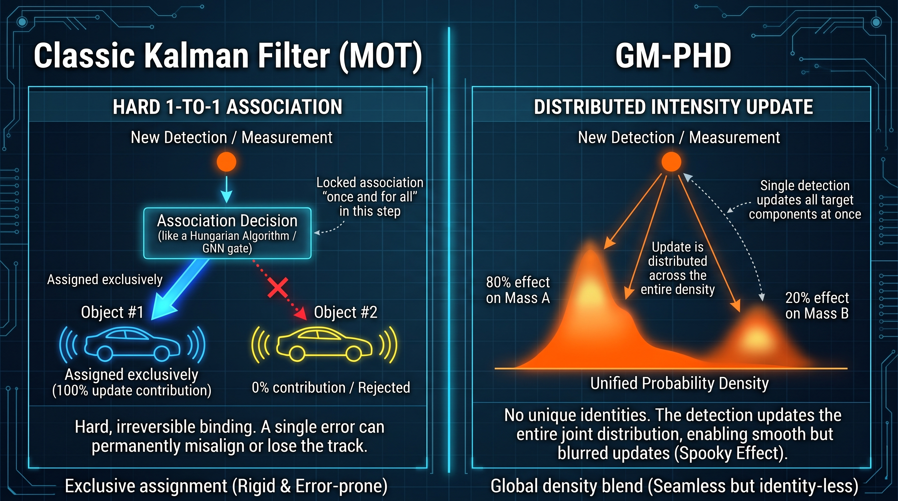
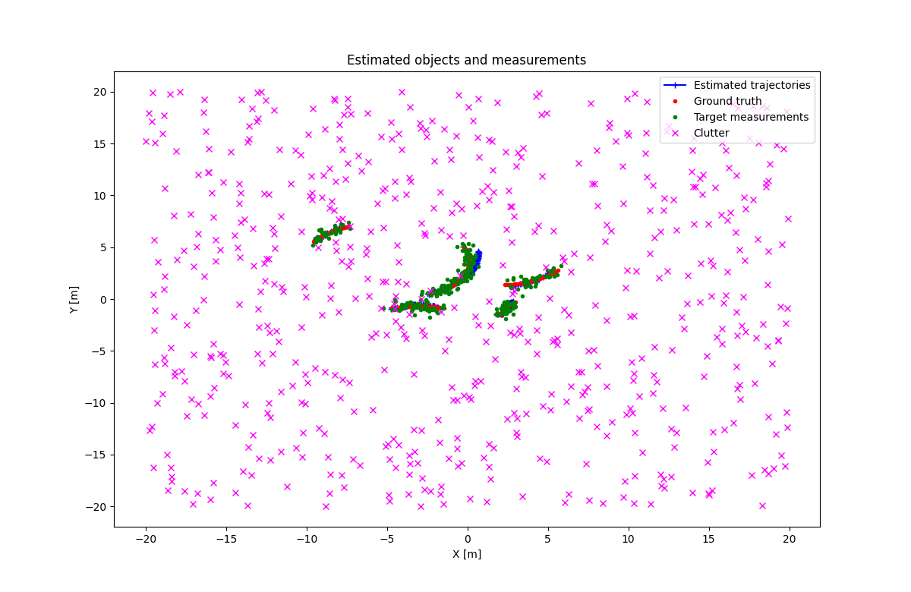
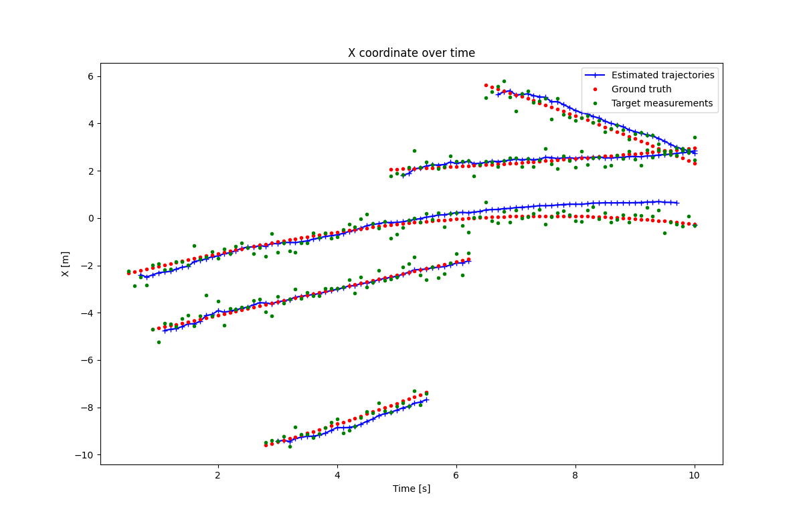
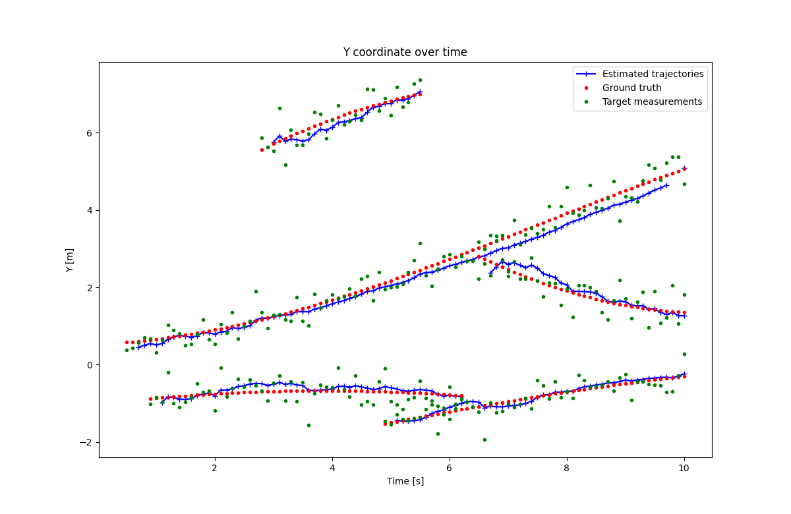
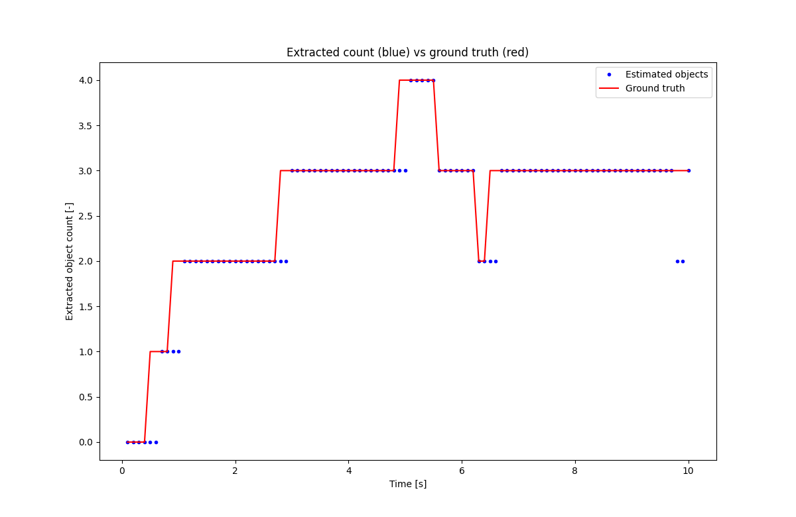
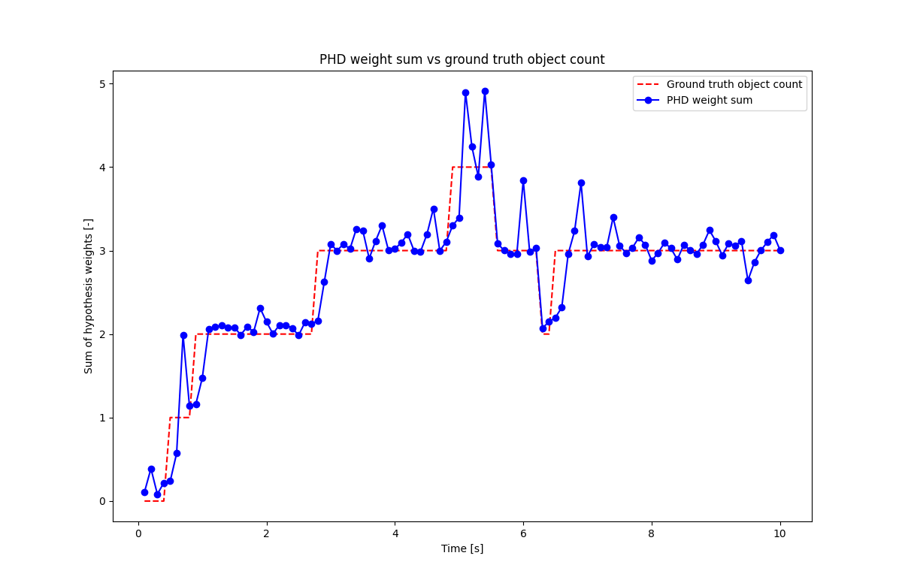
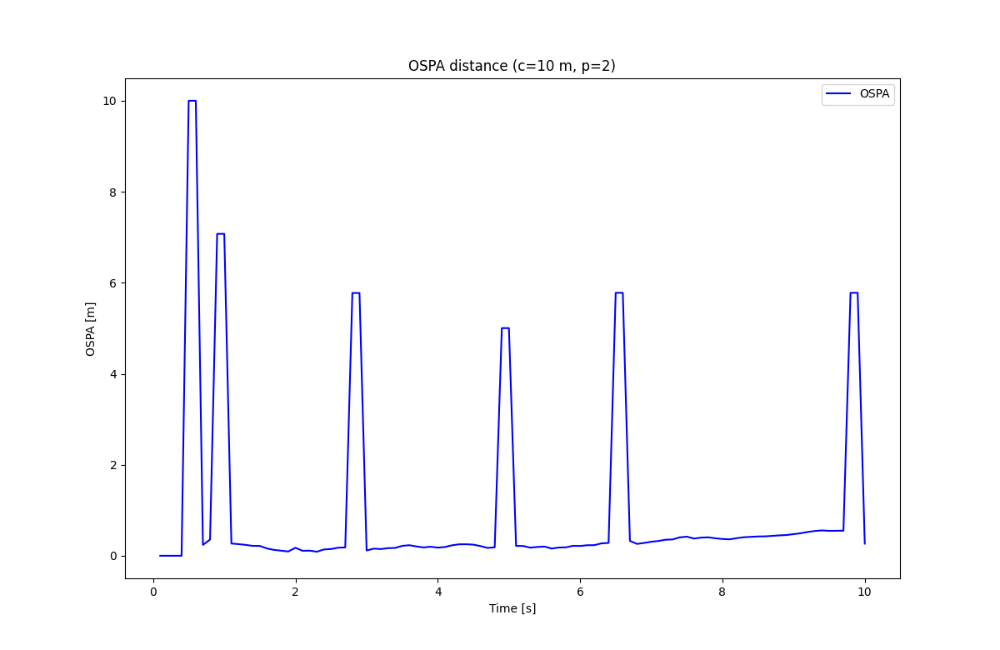

<div align="center">

# GM-PHD

### Gaussian Mixture Probability Hypothesis Density Filter in Modern C++

Multi-object tracking without explicit measurement-to-track association.

[](https://isocpp.org/)
[](https://cmake.org/)
[](https://eigen.tuxfamily.org/)

</div>

## 1. Random Finite Set and PHD Filters

A conventional state estimator describes one target by a fixed-size state
vector. Multi-target tracking is different: the number of targets changes,
measurements may come from targets or clutter, and a measurement is not
assigned to a target in advance. A **Random Finite Set (RFS)** represents the
state as a set whose size and members are random.

The **Probability Hypothesis Density (PHD)** filter estimates the first-order
moment of this random set rather than enumerating every possible association
of measurements and targets. The integral of the PHD intensity over a region
is the expected number of objects in that region. A PHD filter can therefore
recursively estimate:

- the number of active targets;
- target position and velocity;
- position and velocity uncertainty; and
- target births and deaths.

This approach avoids the need for explicit, one-to-one data association at
every scan. Its main advantages are robustness to clutter, missed detections,
and changes in cardinality. It is particularly useful when many targets move
simultaneously and no permanent track identity is required.



*In a conventional Kalman-filter tracking pipeline, measurements are usually
associated with existing tracks before the state update. PHD filtering instead
propagates and corrects a density of target hypotheses, avoiding the need to
enumerate an explicit measurement-to-track association at every scan.*

## 2. The Gaussian Mixture PHD Filter

### GM-PHD concept

The GM-PHD filter approximates the PHD intensity as a weighted mixture of
Gaussian components:

```text
v(x) = sum_i w_i * N(x; m_i, P_i)
```

Here, `w_i` is the component weight, `m_i` is its state mean, and `P_i` is
its covariance. The sum of all component weights estimates the expected
number of objects. Each scan therefore updates a parametric mixture rather
than maintaining a separate estimate for every measurement association.

This implementation uses a constant-velocity (CV) state:

```text
state:      [ x, vx, y, vy ]
measurement:[ x, y ]
```

The four-dimensional state represents position and velocity in the `x` and
`y` directions. Time-varying matrices are prepared for each prediction using
the time difference between scans.

### Prediction

The prediction step propagates every existing hypothesis from the previous
scan:

```text
predicted_weight      = ps * weight
predicted_state       = F * state
predicted_covariance  = F * covariance * F^T + Q
```

The survival probability is `ps`, `F` is the CV transition matrix, and `Q`
models process uncertainty. Existing components lose weight according to the
survival probability, while their state means and covariances are propagated
forward.

Birth hypotheses are handled separately. In the example, a birth hypothesis
is created from every measurement:

- the measured `x` and `y` initialize the position;
- velocity components are initialized with covariance `1/3`;
- the birth weight is only `0.001`.

The low birth weight limits the influence of isolated clutter measurements.
The birth model is part of the implementation interface and can be replaced
by a model that generates births independently or over a predefined region.

### Measurement correction

The missed-detection term is first applied to all predicted hypotheses:

```text
weight = (1 - pd) * predicted_weight
```

For every measurement, the filter then calculates a measurement-updated
Gaussian component using a Kalman gain:

```text
weight = pd * predicted_weight * likelihood(z)
weight /= sum_weight + kappa
```

Here:

- `pd` is the probability of detection;
- `kappa` is the clutter intensity;
- `likelihood(z)` is the Gaussian probability density of the measurement
  given a predicted hypothesis.

The measurement update changes the component weight, mean, and covariance.
As a computational guard, this implementation skips measurement updates when
the two-dimensional position difference exceeds 5 m.

### Pruning and extraction

Prediction and measurement updates can create many components. The
post-processing stage controls that growth:

1. **Pruning** removes components whose weight is below
   `truncation_threshold`.
2. **Merging** combines components that are close in Mahalanobis distance.
   The merged weight is accumulated, and the merged covariance includes both
   component covariance and the spread of component means.
3. **Extraction** returns the remaining components whose weight exceeds
   `extraction_threshold` as estimated objects.

The sum of all PHD hypothesis weights estimates expected cardinality. It is
not always equal to the number of extracted objects: weight sum is a
cardinality estimate, while extraction is a thresholded state estimate.

## 3. Implementation and Interface

### Project layout

```text
include/gm_phd.hpp        GM-PHD filter implementation
include/cv_motion_model.hpp
include/birth_model_base.hpp
include/ospa.hpp          OSPA metric
src/cv_motion_model.cpp   CV model implementation
example/example.cpp       simulation and visualization
tests/                    unit tests
```

The core filter is a C++ template parameterized by a motion model and a birth
model. Eigen provides matrix operations; standard C++ parallel algorithms
and oneTBB accelerate the independent prediction and update operations.

### Configuration

The filter uses named calibration parameters:

```cpp
using Filter = mot::GmPhd<mot::CvMotionModel, mot::BirthModelDummy>;

Filter filter;
filter.SetCalibrations(
    "pd", 0.9,
    "ps", 0.95,
    "kappa", 0.01,
    "truncation_threshold", 0.01,
    "merging_threshold", 4.0,
    "extraction_threshold", 0.5);
```

| Parameter | Meaning |
|---|---|
| `pd` | Probability of detection |
| `ps` | Probability of target survival |
| `kappa` | Clutter intensity |
| `truncation_threshold` | Weight threshold for pruning |
| `merging_threshold` | Mahalanobis threshold for merging |
| `extraction_threshold` | Minimum weight for object extraction |

`SetCalibrations()` accepts name/value pairs and returns `std::expected`. An
unknown name or a value of the wrong type produces an error.

### Main interface

Each scan is processed by `Run`:

```cpp
using Measurement = mot::ValueWithCovariance<2>;

std::vector<Measurement> measurements;
filter.Run(timestamp, measurements);
const auto& objects = filter.GetObjects();
```

- `timestamp` is the current scan time and determines the prediction interval;
- `measurements` is a vector of two-dimensional position measurements with
  covariances;
- `GetObjects()` returns the current threshold-extracted objects, each with
  a state vector and covariance;
- `GetWeightsSum()` returns the sum of the current PHD hypothesis weights.

A custom motion model must provide:

- transition and observation matrices;
- state and measurement prediction;
- predicted covariance and innovation covariance;
- Kalman gain and posterior covariance.

A custom birth model derives from `BirthModelBase` and implements
measurement-conditioned birth generation and the optional fixed birth count.

### Example configuration

The visualization example generates 100 scans with a 0.1 s interval. Objects
follow constant-turn-rate trajectories, but the filter uses a constant-
velocity model. Each scan contains noisy target detections and an average of
eight uniformly distributed clutter measurements in
`[-20, 20] x [-20, 20]`.

The example uses:

- detection probability `pd = 1.0`, because no missed target detections are
  generated;
- measurement noise covariance `0.09 I`;
- filter observation covariance `0.36 I`;
- a fixed random seed for reproducibility.

The intentionally larger observation covariance produces smoother tracks at
the cost of slightly larger position errors.

## 4. Results and the OSPA Metric

### OSPA

The **Optimal Subpattern Assignment (OSPA)** metric compares an estimated
set with the ground-truth set at each scan. It first optimizes the assignment
between matching sets and then includes cardinality differences.

For cutoff `c` and order `p`, OSPA is:

```text
OSPA_p(X,Y;c) =
  ((1/n) * [sum(localization distances^p) +
            c^p * (n - m)])^(1/p)
```

Here, `n` is the larger cardinality, `m` is the number of matched objects,
and each individual localization distance is capped at `c`.

- **Localization error:** lower is better for matched objects.
- **Cardinality error:** missing or extra objects contribute a cutoff penalty.
- **Order `p`:** with `p = 2`, larger errors have more influence than small
  errors.
- **Interpretation:** zero means perfect position and cardinality agreement;
  a higher value indicates position or count error.

The example uses `c = 10 m` and `p = 2` for each scan and reports the mean
OSPA over the complete run.

### Parameter tuning

Before plotting, the example evaluates filter configurations on 50
deterministic simulation runs. All candidates are evaluated on the same runs,
and each candidate is scored by mean OSPA across every scan and run.

The coordinate search tunes:

- survival probability `ps`;
- clutter intensity `kappa`;
- truncation threshold;
- merging threshold;
- extraction threshold.

`pd` remains fixed at `1.0` because the simulator does not generate missed
target detections. This setup is a small reproducible example, not a held-out
validation or a general performance guarantee.

The initial mean OSPA was `1.18882 m`. Coordinate search selected:

| Parameter | Value |
|---|---:|
| `pd` | 1.0 |
| `ps` | 0.8 |
| `kappa` | 0.01 |
| `truncation_threshold` | 0.005 |
| `merging_threshold` | 4.0 |
| `extraction_threshold` | 0.5 |

The selected configuration achieved:

- mean OSPA `0.999403 m` across the 50 tuning runs;
- mean OSPA `1.02158 m` on the first run used for plotting.

### Results plots

#### Estimated trajectories and measurements



The XY plot compares extracted tracks with ground truth, target
measurements, and clutter. It shows the motion approximation and occasional
loss or replacement of an estimated target.

#### Position over time



The X-coordinate plot compares estimated trajectories, ground truth, and
target measurements over the 100-scan sequence.



The Y-coordinate plot shows the corresponding vertical motion and the
estimated tracks linked between scans.

#### Extracted versus true object count



The extracted count follows the true cardinality in much of the run. Visible
disagreements coincide with targets appearing, disappearing, or being
missing from an extraction.

#### PHD weight sum versus true cardinality



The PHD weight sum is an estimate of expected cardinality. It can remain
close to the true count even when the threshold-extracted object list
contains a temporary cardinality error.

#### OSPA over time



OSPA is low while object count and position agree with ground truth. Peaks
close to the 10 m cutoff occur when the estimate misses or adds objects;
before or after these transitions, typical localization errors are below
1 m.

### Experimental interpretation

The ground truth follows constant-turn-rate trajectories, while the filter
assumes constant velocity. The CV model is therefore a deliberate
approximation. OSPA depends on the random seed and selected calibration, so
the reported values describe this reproducible scene only.

## Requirements

### Core library

- CMake 3.22 or newer;
- a C++26-capable compiler;
- Eigen3;
- oneTBB.

The optional visualization example additionally requires:

- Python 3;
- NumPy;
- Matplotlib;
- Python development headers and libraries.

## Build and Run

Configure, build, and test the library:

```bash
git clone https://github.com/borodziejciesla/gm-phd.git
cd gm-phd

cmake -S . -B build \
  -DBUILD_TESTS=ON \
  -DBUILD_EXAMPLE=ON
cmake --build build -j
ctest --test-dir build --output-on-failure
```

Run the visualization example:

```bash
./build/example/gm-phd_example
```

The example tunes the 50-run configuration, prints scan metrics, and writes
the six plots to `fig/`.

To build only the library and tests:

```bash
cmake -S . -B build -DBUILD_EXAMPLE=OFF -DBUILD_TESTS=ON
cmake --build build -j
```

## References

- Zachary Prihoda, Arec Jamgochian, Ben Moore, Bernard Lange,
  *Probability Hypothesis Density Filter Implementation and Application*.
- Karl Granström, Christian Lundquist, Umut Orguner,
  *A Gaussian Mixture PHD Filter for Extended Target Tracking*.
- Karl Granström, Christian Lundquist, Umut Orguner,
  *Extended Target Tracking Using a Gaussian Mixture PHD Filter*.
- Wenling Li, Yingmin Jia, Junping Du,
  *Gaussian Mixture PHD Filter for Multiple Maneuvering Extended Targets Tracking*.

This project is a research and experimentation implementation. Interfaces
and calibration names may change as additional motion and birth models are
added.
